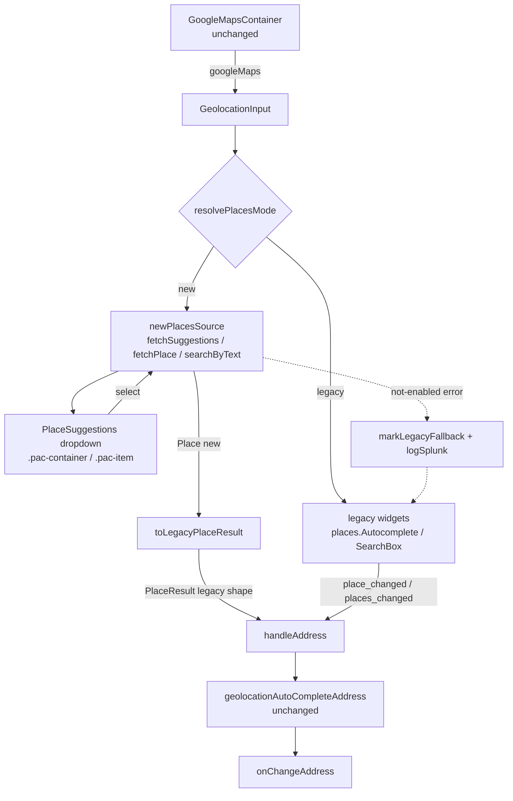
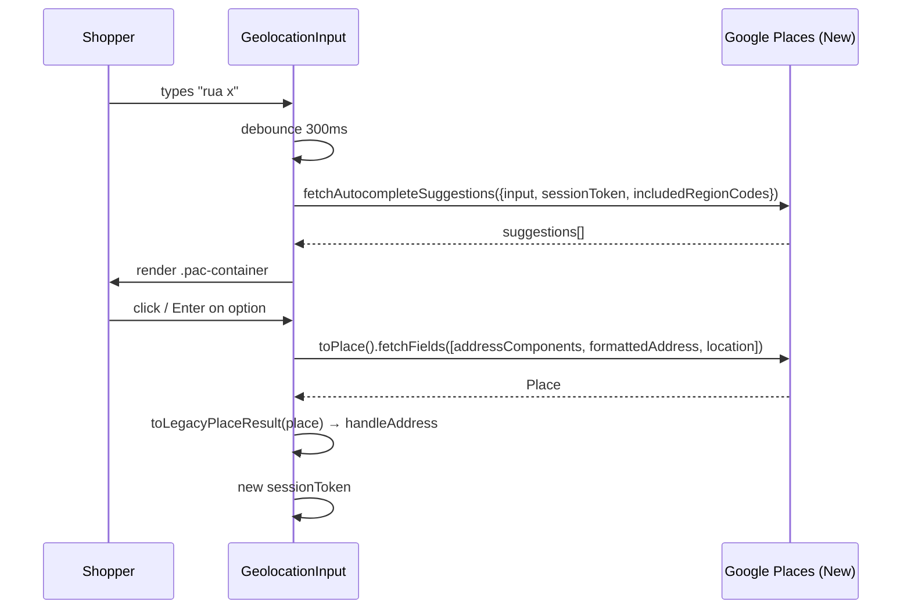

# Places API (New) migration for GeolocationInput

> **Status**: Draft
> **Created**: 2026-11-04

## 1. Business Context

### Problem Statement

`GeolocationInput` (`react/geolocation/GeolocationInput.js`) builds its address autocomplete on Google's **legacy Places API** widgets:

- `google.maps.places.Autocomplete`, the default, which calls `AutocompletionService.GetPredictions`.
- `google.maps.places.SearchBox`, used when `useSearchBox` is set, which calls `AutocompletionService.GetQueryPredictions`.

Since 2025-03-01, Google no longer lets Google Cloud projects that did not already use the legacy Places API enable it. A Maps API key from such a project gets `LegacyApiNotActivatedMapError`, and the address search shows no suggestions. Anyone affected cannot use geolocation-based address entry in checkout (`vtex.omnishipping`), the shipping preview (`vtex.shipping-preview`) or `vtex.checkout`: new merchants, merchants who rotate to a new GCP project, and developers testing locally.

Merchants whose keys come from older projects still work today. Some of those keys may have **only** the legacy API enabled, so switching straight to the new API would break them.

### Goals

- `GeolocationInput` returns suggestions and fills the address with a key that has **only** Places API (New) enabled.
- `GeolocationInput` keeps working with a key that has **only** the legacy Places API enabled.
- For the same Google place, the address produced is identical to the one the legacy flow produces today.
- Consumers make zero code changes: no changes to `react/index.ts`, `react/components.ts`, `react/inputs.ts`, `react/types/rules.ts`, `react/country/*.ts`, or any exported component's props. Ships as a minor release (`feat:`).

### User Stories

#### US-1: Address search with a new Google Cloud project key

- **Story**: As a shopper on a store whose Maps key only has Places API (New) enabled, I want to type my address and pick a suggestion, so that my address fields are filled automatically.
- **Acceptance Criteria**:
  - **Given** a key with only Places API (New) enabled and country rules with `abbr: 'BR'`, **when** the shopper types at least one character in the address input, **then** a suggestions list restricted to region `br` appears under the input after the debounce window.
  - **Given** the suggestions list is open, **when** the shopper clicks a suggestion, **then** place details are fetched (`addressComponents`, `formattedAddress`, `location`), `onChangeAddress` is called once with the address produced by `geolocationAutoCompleteAddress`, and the input value becomes the place's formatted address.
  - **Given** a selection was completed, **when** the shopper starts typing again, **then** a new session token is used for the next suggestions request.

#### US-2: Address search with a legacy-only key (fallback)

- **Story**: As a shopper on a store whose Maps key only has the legacy Places API enabled, I want address search to keep working as it does today, so that the migration does not break my checkout.
- **Acceptance Criteria**:
  - **Given** a key where the new API rejects requests (the API is not enabled or not authorized), **when** the first suggestions request fails, **then** the component switches to the legacy `places.Autocomplete` widget (or `places.SearchBox` when `useSearchBox` is set) on the same input element, and subsequent typing behaves exactly as before this change.
  - **Given** `google.maps.places.AutocompleteSuggestion` is undefined (an old Maps JS version was loaded), **when** the input mounts, **then** the component uses the legacy widget directly.
  - **Given** the fallback was triggered once in the page, **when** another `GeolocationInput` mounts on the same page, **then** it goes straight to legacy mode without retrying the new API.
  - **Given** the fallback is triggered, **then** a single `window.logSplunk` event is emitted (via `react/metrics.ts`) identifying the fallback reason.

#### US-3: Keyboard and accessibility

- **Story**: As a keyboard or screen-reader user, I want to navigate and select suggestions without a mouse, so that address search is accessible.
- **Acceptance Criteria**:
  - **Given** the suggestions list is open, **when** the user presses ArrowDown/ArrowUp, **then** the active option moves (wrapping at the ends) and the input's `aria-activedescendant` points to it.
  - **Given** an option is active, **when** the user presses Enter, **then** that option is selected exactly as a click would select it.
  - **Given** the list is open, **when** the user presses Escape or the input loses focus, **then** the list closes and no selection is made.
  - **Given** the list is rendered, **then** the input has `role="combobox"`, `aria-expanded` and `aria-controls`, and the list has `role="listbox"` with `role="option"` children.

#### US-4: SearchBox mode (`useSearchBox`)

- **Story**: As a consumer that passes `useSearchBox`, I want Enter without picking a suggestion to resolve the typed text, so that the current SearchBox behavior is preserved.
- **Acceptance Criteria**:
  - **Given** `useSearchBox` is true, suggestions are loaded and none is active, **when** the user presses Enter, **then** the first suggestion is selected.
  - **Given** `useSearchBox` is true and no suggestions were returned, **when** the user presses Enter, **then** `Place.searchByText({ textQuery, fields, includedRegionCode })` is called and its first result is used. If there is no result, nothing changes.
  - **Given** `useSearchBox` is false and no option is active, **when** the user presses Enter, **then** nothing is selected, matching the legacy `Autocomplete` behavior.

### Key Scenarios

| Scenario | Pre-conditions | Steps | Expected Result |
|---|---|---|---|
| Happy path (new API) | Key with Places API (New); BRA rules | Type "Praia de Botafogo 300", click first suggestion | Fields filled; `country: 'BRA'`; `geoCoordinates` = `[lng, lat]`; `addressQuery` = formatted address; `geolocationAutoCompleted` flags set |
| Parity with legacy | Same `place_id` resolved by both flows | Feed legacy `PlaceResult` and adapted new `Place` into `geolocationAutoCompleteAddress` | Deep-equal output addresses |
| ARG CABA handler | ARG rules; place in Ciudad Autónoma de Buenos Aires | Select suggestion | `state` and `city` = "Ciudad Autónoma de Buenos Aires" (handler reads adapted `address_components`) |
| Legacy-only key (fallback) | New API rejects with not-enabled error | Type text | Legacy widget attached; `.pac-container` from Google appears; one Splunk fallback event |
| Old Maps JS version | `places.AutocompleteSuggestion` undefined | Mount input | Legacy widget attached; no new-API call |
| Network error mid-session | New API worked earlier; one request fails with a transient error | Type text | List closes for that keystroke; no fallback; next keystroke retries the new API |
| No results | Query matches nothing | Type gibberish | List stays closed; no text rendered (no new i18n key) |
| Place without geometry | `fetchFields` returns no `location` | Select suggestion | `onChangeAddress` not called (matches the legacy `if (googleAddress.geometry)` guard) |
| Fast typing | Debounce 300 ms | Type 8 characters in 200 ms | One suggestions request; results of stale requests are discarded |
| Rules change | Country switched from BRA to USA while the list is open | Change country | List closes; next request uses `includedRegionCodes: ['us']`; new session token |
| `loadingGoogle` true | Maps still loading | Type | Input keeps the current no-op `onChange`; no request |
| Unmount during request | Request in flight | Unmount component | No `setState` on an unmounted component; no `onChangeAddress` call |

### Functional Requirements

- FR-1: Use `google.maps.places.AutocompleteSuggestion.fetchAutocompleteSuggestions` with an `AutocompleteSessionToken` per search session (new token after each selection, rules change or unmount).
- FR-2: Restrict suggestions with `includedRegionCodes: [rules.abbr.toLowerCase()]` when `rules.abbr` is set, and with no region filter otherwise. Pass `language` from the locale already used by the loader.
- FR-3: On selection, call `placePrediction.toPlace().fetchFields({ fields: ['addressComponents', 'formattedAddress', 'location'] })` and request **only** these fields.
- FR-4: Convert the new `Place` to the legacy `PlaceResult` shape with a pure adapter before calling `geolocationAutoCompleteAddress`, so that `geolocationAutoCompleteAddress`, `GeolocationRules` handlers and all `react/country/*.ts` files stay untouched.
- FR-5: Render a suggestions dropdown under the existing `Input` (the `Input` prop, `DefaultInput` by default), using the existing `inputRef` mount point. Do not replace the input element.
- FR-6: The dropdown uses class names `pac-container` (list) and `pac-item` (option) so that existing selectors (omnishipping Cypress `cy.get('.pac-item')`, merchant CSS) keep working. Each option shows the prediction's main and secondary text.
- FR-7: Fall back to the legacy widgets when the new API is unavailable (FR-8). The fallback decision is cached at module level for the page lifetime.
- FR-8: "Unavailable" means: `AutocompleteSuggestion` is undefined, **or** `fetchAutocompleteSuggestions` rejects with an error whose message or code indicates the API is not enabled or not authorized (for example `PERMISSION_DENIED`, `REQUEST_DENIED`, "API has not been used", "not authorized"). Other errors (network, rate limit) do not trigger the fallback.
- FR-9: Debounce suggestion requests (300 ms). Ignore responses that arrive for a query that is no longer current.
- FR-10: Preserve the `useSearchBox` semantics described in US-4.
- FR-11: No new keys in `messages/en.json`.

### Non-Functional Requirements

- **Compatibility**: React 15/16 peer range; no hooks in `GeolocationInput` if that would conflict with the class-based HOC chain (`injectAddressContext`, `injectRules`, `injectIntl`). New subcomponents may be function components.
- **Dependencies**: No new npm dependencies. Keep `load-google-maps-api`.
- **Cost**: One autocomplete session plus one Place Details (Essentials fields) per completed selection. Never request Pro/Enterprise fields.
- **Accessibility**: WAI-ARIA combobox pattern (US-3).
- **Performance**: At most one in-flight suggestions request per input. Close the list on blur with a short delay so that clicks on options register.
- **TypeScript**: New files in TS 3.9-compatible syntax. `GeolocationInput.js` may stay JS.

### Out of Scope

- `Map.js`, `Utils.js` (`getAddressByGeolocation`) and any use of `google.maps.Geocoder`, `Map` or `Marker`. These are not legacy Places APIs.
- Changes to `GeolocationRules`, `PostalCodeRules` or any country rule file.
- Migrating `GoogleMapsContainer` to `importLibrary` / the dynamic bootstrap loader.
- Removing the legacy widget path. That is a future major version, once Google retires legacy Places for existing keys.
- Changes in `vtex.omnishipping`, `vtex.shipping-preview` or `vtex.checkout`.
- Showing "no results" or error text in the dropdown.

---

## 2. Arch Decisions

### Proposed Solution

Introduce a small **places provider** abstraction inside `react/geolocation/`, with two implementations: `new`, built on Places API (New), and `legacy`, built on today's widgets. `GeolocationInput` asks a resolver which provider to use. With the new provider, it renders a controlled suggestions dropdown under the existing `Input`. On selection, the new `Place` goes through `toLegacyPlaceResult()` and then into the unchanged `handleAddress(googleAddress)` path. With the legacy provider, the current code path attaches the Google widget to the input exactly as today.

### Architecture Overview



Sequence for the new path:



### Alternatives Considered

| Alternative | Pros | Cons | Verdict |
|---|---|---|---|
| `PlaceAutocompleteElement` web component | Google-maintained UI, little code | Renders its own `<input>` in shadow DOM; breaks the `Input`, `inputProps`, `placeholder`, `autoFocus` props and consumer styling; hard to theme; no `.pac-item` selectors | Rejected: breaking for consumers |
| Change `geolocationAutoCompleteAddress` and the country rules to the new shape (`longText`/`shortText`) | No adapter layer | Touches 64 rule files and `GeolocationRule.valueIn` semantics; `handler` signatures change; requires a major version | Rejected: breaking change |
| New API only, no legacy fallback | Simpler; one code path | Breaks merchants whose key has only the legacy API enabled | Rejected: production risk |
| Opt-in prop (`usePlacesApiNew`) | Zero risk to current traffic | Requires every consumer to change; does not fix the issue by default | Rejected: violates the "changes only in address-form" goal |
| Legacy first, new on `LegacyApiNotActivatedMapError` | Current traffic untouched | The legacy error is only reported through the console/`gm_authFailure`, not catchable per request; detection is unreliable | Rejected |
| **New API first, legacy fallback on a catchable error** | Works for both key types; the error is a rejected promise | Two code paths to maintain until the legacy path is removed | **Accepted** |

### Risks & Mitigations

| Risk | Impact | Likelihood | Mitigation |
|---|---|---|---|
| Legacy-only keys break | High | Med | FR-7/FR-8 fallback; unit tests for each error class; Splunk event to measure how many stores fall back |
| Fallback misclassifies a transient error as "not enabled" | Med | Low | Fallback only on explicit permission/not-enabled signatures; other errors just close the list |
| Address output differs from the legacy flow (e.g. `short_name` for `administrative_area_level_1`) | High | Med | Adapter maps `shortText` to `short_name` 1:1; parity test with the same fixture in both shapes; manual QA BRA/ARG/USA |
| omnishipping Cypress or merchant CSS rely on Google's DOM | Med | Med | Keep `.pac-container` / `.pac-item` class names and the list placed under the input |
| Places (New) billing differs from legacy | Med | Med | Session tokens + Essentials-only fields; flag in the PR for the team that owns Maps billing |
| Consumers: `vtex.omnishipping`, `vtex.shipping-preview`, `vtex.checkout`, external npm users of `GeolocationInput` | Med | Low | No public API change; release as minor; announce in the CHANGELOG; QA in omnishipping on a linked workspace before release |
| Old Maps JS version cached without `AutocompleteSuggestion` | Low | Low | Feature-detect and fall back |
| Blur closes the list before the click registers | Low | Med | Select on `mousedown` (with `preventDefault`) instead of `click` |

### Key Decisions

#### Decision 1: Adapter to the legacy `PlaceResult` shape

- **Status**: Accepted
- **Context**: `geolocationAutoCompleteAddress` and every `GeolocationRule` (`valueIn: 'long_name' | 'short_name'`, and handlers such as `ARG.isCABA` that read `address_components`) depend on the legacy shape. Changing it is a breaking change to `PostalCodeRules`.
- **Decision**: Add `toLegacyPlaceResult(place)` in `react/geolocation/` and feed its output into the existing `handleAddress`.
- **Consequences**: Zero change to rules and the transform. The adapter becomes the single place that knows both shapes. A future major can invert this.

#### Decision 2: Own dropdown instead of `PlaceAutocompleteElement`

- **Status**: Accepted
- **Context**: Consumers inject their own `Input` (e.g. `StyleguideInput`) and rely on `inputProps`, `placeholder`, `autoFocus` and `inputRef`.
- **Decision**: Use the programmatic API and render a `PlaceSuggestions` list next to the existing `Input`, with `.pac-container` / `.pac-item` classes.
- **Consequences**: More code (keyboard, a11y, blur handling) owned by this repo, but the component contract is preserved.

#### Decision 3: New-first with page-wide fallback to legacy

- **Status**: Accepted
- **Context**: Some keys have only the new API, some only the legacy one. Only the new API reports a catchable per-request error.
- **Decision**: Try the new API first. On a not-enabled/permission error, or if the classes are missing, switch to legacy for the rest of the page lifetime and log one Splunk event.
- **Consequences**: One extra failed request for legacy-only stores on the first keystroke; the shopper needs to type one more character for the legacy widget to show suggestions. That is acceptable, and the Splunk data tells us when the legacy path can be removed.

#### Decision 4: Telemetry through `react/metrics.ts`

- **Status**: Accepted
- **Context**: The repo uses `window.logSplunk` for geolocation monitoring.
- **Decision**: Add a `logPlacesApiFallback({ reason, country })` helper to `react/metrics.ts` (additive; existing calls untouched).
- **Consequences**: Lets us measure how many stores still depend on the legacy API.

### Implementation Plan

1. **Adapter**: `toLegacyPlaceResult` + unit tests, including a parity fixture against `geolocationAutoCompleteAddress` and the ARG CABA case.
2. **New source**: `newPlacesSource` (`fetchSuggestions`, `fetchPlace`, `searchByText`, `isPlacesApiNewUnavailableError`) + mocks in `react/geolocation/__mocks__/` + unit tests.
3. **Mode resolver + telemetry**: `resolvePlacesMode` / `markLegacyFallback` (module cache) + `logPlacesApiFallback` in `metrics.ts`.
4. **Dropdown**: `PlaceSuggestions` component with the combobox/listbox a11y pattern; RTL tests for mouse and keyboard.
5. **GeolocationInput wiring**: debounce, session tokens, stale-response guard, `useSearchBox` semantics, legacy path kept as is; rewrite `GeolocationInput.test.tsx` with RTL covering both modes.
6. **Docs/CHANGELOG**: `### Added` entry under `## [Unreleased]` naming Places API (New) support, the fallback and the Splunk event.
7. **Manual QA**: demo app with a new-API-only key and a legacy-only key for BRA, ARG and USA; `vtex link` into an omnishipping workspace and run the delivery/pickup geolocation flows.

---

## 3. Technical Contract

### Data Models

Legacy shape produced by the adapter. This is the existing contract consumed by `geolocationAutoCompleteAddress` and rule handlers; it does not change:

```ts
interface LegacyAddressComponent {
  long_name: string
  short_name: string
  types: string[]
}

interface LegacyPlaceResult {
  address_components: LegacyAddressComponent[]
  formatted_address: string
  geometry: {
    location: { lat: () => number; lng: () => number }
  }
}
```

Mapping from Places API (New) `Place`:

| `Place` (new) | `LegacyPlaceResult` |
|---|---|
| `addressComponents[i].longText` | `address_components[i].long_name` |
| `addressComponents[i].shortText` | `address_components[i].short_name` |
| `addressComponents[i].types` | `address_components[i].types` |
| `formattedAddress` | `formatted_address` |
| `location` (`LatLng`) | `geometry.location` (same `LatLng` instance; exposes `lat()`/`lng()`) |
| `location` missing | `geometry` omitted, so `handleAddress` is skipped |
| `addressComponents` missing | `address_components: []` |

Internal suggestion view model:

```ts
interface SuggestionItem {
  id: string            // placePrediction.placeId
  mainText: string      // placePrediction.mainText.text
  secondaryText: string // placePrediction.secondaryText?.text ?? ''
  prediction: google.maps.places.PlacePrediction
}
```

### Interfaces

Public (unchanged): `GeolocationInput` props: `Input`, `inputProps`, `placeholder`, `useSearchBox`, `rules`, `address`, `onChangeAddress`, `loadingGoogle`, `autoFocus`, `googleMaps`. `GoogleMapsContainer` render-prop `{ loading, googleMaps }`. No additions or removals.

Internal (new, under `react/geolocation/`; none exported from `index.ts`, `components.ts` or `inputs.ts`):

```ts
// placesAdapter.ts
export function toLegacyPlaceResult(place: google.maps.places.Place): LegacyPlaceResult

// placesMode.ts
export type PlacesMode = 'new' | 'legacy'
export function resolvePlacesMode(googleMaps: typeof google.maps): PlacesMode
export function markLegacyFallback(reason: string, country?: string): void // caches + logs once
export function isPlacesApiNewUnavailableError(error: unknown): boolean

// newPlacesSource.ts
export function createSessionToken(googleMaps: typeof google.maps): google.maps.places.AutocompleteSessionToken
export function fetchSuggestions(
  googleMaps: typeof google.maps,
  params: { input: string; sessionToken: AutocompleteSessionToken; regionCode?: string; language?: string }
): Promise<SuggestionItem[]>
export function fetchPlace(prediction: PlacePrediction): Promise<google.maps.places.Place>
export function searchByText(
  googleMaps: typeof google.maps,
  params: { textQuery: string; regionCode?: string }
): Promise<google.maps.places.Place | null>

// PlaceSuggestions.tsx
interface PlaceSuggestionsProps {
  id: string                       // listbox id for aria-controls
  items: SuggestionItem[]
  activeIndex: number              // -1 = none
  onSelect: (item: SuggestionItem) => void
  onHover: (index: number) => void
}

// metrics.ts (additive)
export function logPlacesApiFallback(params: { reason: string; country?: string }): void
```

### Integration Points

- **Google Maps JS API** (loaded by the unchanged `googleMaps.js` with `libraries: ['places']`): `places.AutocompleteSuggestion`, `places.AutocompleteSessionToken`, `places.PlacePrediction.toPlace`, `places.Place.fetchFields`, `places.Place.searchByText`; legacy `places.Autocomplete`, `places.SearchBox`, `Geocoder` for the fallback.
- **`geolocationAutoCompleteAddress`**: called with `(state.address, legacyPlaceResult, rules)`, unchanged.
- **`react/metrics.ts`**: new `logPlacesApiFallback` → `window.logSplunk`.
- **Consumers**: `vtex.omnishipping` (`DeliveryContainer`, `InvoiceAddressForm`), `vtex.shipping-preview` (`PostalCode`), `vtex.checkout`: no changes required.

### Invariants & Constraints

- `geolocationAutoCompleteAddress`, `react/types/rules.ts`, `react/country/*.ts`, `react/index.ts`, `react/components.ts` and `react/inputs.ts` are not modified.
- `onChangeAddress` is called at most once per selection, and only when the resolved place has a location.
- For the same place, `geolocationAutoCompleteAddress(base, toLegacyPlaceResult(newPlace), rules)` deep-equals `geolocationAutoCompleteAddress(base, legacyPlaceResult, rules)`.
- Only the `addressComponents`, `formattedAddress` and `location` fields are ever requested from Place Details.
- A session token is never reused after a selection.
- Once legacy mode is chosen in a page, the new API is not called again in that page.
- No new keys in `messages/en.json`; no new npm dependencies.
- The dropdown root has class `pac-container` and each option has class `pac-item`.
